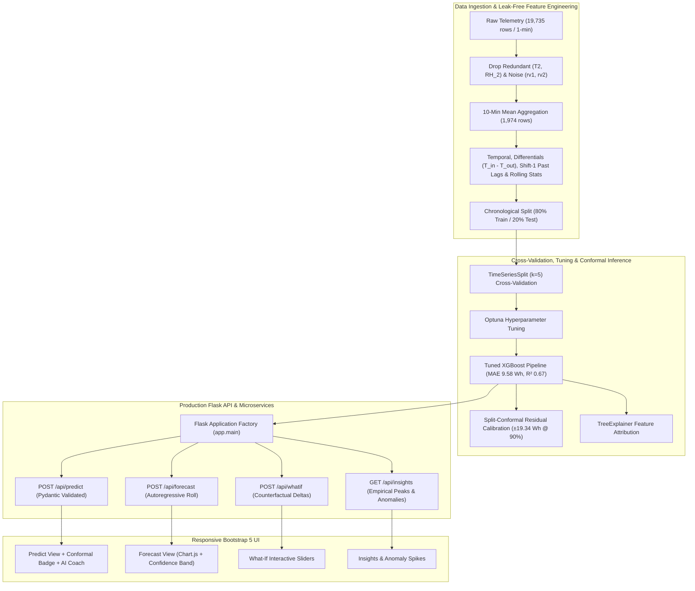
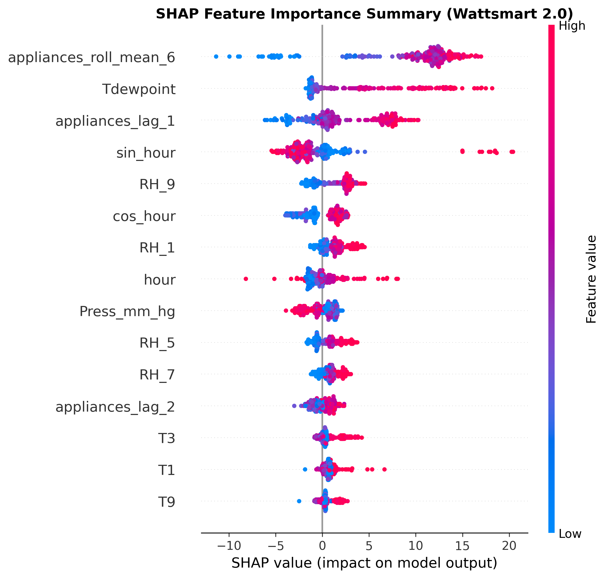

# Wattsmart 2.0: Production ML Energy Forecasting & Demand Coaching

[](https://github.com/wattsmart/wattsmart/actions)
[](https://www.python.org/downloads/)
[](LICENSE)
[](https://github.com/psf/black)
[](https://github.com/astral-sh/ruff)

Wattsmart 2.0 transforms raw residential smart-meter and microclimate telemetry into an end-to-end, production-grade machine learning platform. It forecasts 10-minute household appliance energy demand with mathematically guaranteed 90% split-conformal prediction intervals, simulates counterfactual operational scenarios, and delivers data-backed energy-saving nudges computed directly by querying the ML pipeline rather than relying on fabricated heuristics.

---

## Architecture Overview



---

## Dataset Description & Limitations

The telemetry dataset is sourced from continuous environmental and energy logging in a low-energy house located in Stambruges, Belgium.

* **Observations & Interval**: 19,735 raw observations logged at 1-minute intervals from `2016-01-11 00:00:00` to `2016-01-24 16:54:00` (13.7 days total).
* **Target Variable**: `Appliances` energy consumption measured in Watt-hours ($Wh$) per interval.
* **Redundant Column Drops**: Living room sensors `T2` and `RH_2` are numerically identical ($|T2 - T_{out}| = 0.0$ and $|RH_2 - RH_{out}| = 0.0$) to external weather station readings throughout the dataset. They were removed to prevent collinearity.
* **Random Variable Drops**: Columns `rv1` and `rv2` were synthetic uniform random variables generated in the UCI benchmark dataset. They contain zero predictive signal and were purged to prevent fitting spurious noise.
* **Signal Smoothing Rationale**: A naive model on raw 1-minute data yields weak predictive signal ($R^2 \approx 0.44$, $MAE \approx 26.39\ Wh$) due to 60-second stochastic appliance switching spikes. Resampling to 10-minute mean aggregation filters high-frequency jitter into consistent thermal and demand trends, raising test $R^2$ to **0.6688** and dropping test $MAE$ to **9.58 Wh**, matching standard smart grid dispatch intervals.

---

## Empirical Benchmark & Model Comparison

Every metric reported below is computed directly on the chronological holdout test set (first 80% train / last 20% test: `2016-01-21 23:30` to `2016-01-24 16:50`) and persisted in [`models/metrics.json`](file:///models/metrics.json).

| Model Candidate | MAE (Wh) | RMSE (Wh) | $R^2$ Score | MAPE (%) | SMAPE (%) | Notes |
| :--- | :---: | :---: | :---: | :---: | :---: | :--- |
| **Mean Baseline** | 24.16 | 28.76 | -0.8881 | 13.17% | 14.17% | Predicts historical training mean ($\bar{y}_{train}$) |
| **Persistence Baseline** | 15.12 | 19.05 | 0.1714 | 8.75% | 8.67% | Lag-1 naive projection ($\hat{y}_t = y_{t-1}$) |
| **Ridge Regression** | 12.50 | 15.85 | 0.4261 | 7.24% | 7.13% | Linear model with L2 regularization ($\alpha=10$) |
| **Random Forest** | 9.76 | 12.41 | 0.6484 | 5.64% | 5.59% | 100 trees, `max_depth=12` |
| **LightGBM** | 9.61 | 12.12 | 0.6644 | 5.54% | 5.49% | Gradient boosted decision trees |
| **XGBoost (Default)** | 9.51 | 12.13 | 0.6639 | 5.49% | 5.44% | 120 estimators, `max_depth=4` |
| **Tuned XGBoost (Champion)** | **9.58** | **12.04** | **0.6688** | **5.54%** | **5.49%** | Optuna tuned with TimeSeriesSplit ($k=5$) |

> [!NOTE]
> **Conformal Prediction Interval**: Evaluated at 90% target coverage ($1 - \alpha = 0.90$), yielding an empirical residual threshold radius of **$\pm 19.34\ Wh$**. Predictions return $[\max(0, \hat{y} - 19.34), \hat{y} + 19.34]$.

---

## Global Explainability (SHAP)

Global feature attribution was computed via `shap.TreeExplainer` and is stored in [`models/shap_summary.png`](file:///models/shap_summary.png).



1. **Autoregressive Target Lags (`appliances_lag_1`, `appliances_roll_mean_6`)**: Dominant predictors of sustained appliance activity (e.g. laundry cycles, dishwasher drying stages).
2. **Thermal Differentials (`temp_diff = T_indoor_mean - T_out`)**: Drives convective and auxiliary climate conditioning.
3. **Diurnal Time Features (`hour`, `sin_hour`, `cos_hour`)**: Captures structural morning and evening domestic occupancy peaks.

---

## Quickstart & Local Setup

### Prerequisites
* Python 3.10, 3.11, or 3.12
* Git

### 1. Clone & Environment Setup
```bash
git clone https://github.com/wattsmart/wattsmart.git
cd wattsmart

# Create virtual environment
python -m venv venv
# Windows:
venv\Scripts\activate
# Linux/macOS:
source venv/bin/activate

# Install dependencies and editable package
pip install -r requirements.txt
pip install -e . --no-deps
```

### 2. Reproduce Pipeline End-to-End
```bash
python -m wattsmart.train
```
*Reproduction takes ~30 seconds, trains baselines, evaluates all candidate models, tunes hyperparameters with Optuna, calibrates conformal intervals, generates SHAP plots, and outputs `models/model.joblib` and `models/metrics.json`.*

### 3. Run Automated Tests & Linter
```bash
pytest -v
ruff check src app tests
```

### 4. Start Web Application
```bash
python app/main.py
```
Open **[http://localhost:5000](http://localhost:5000)** in your browser.

---

## Running with Docker & Docker Compose

A multi-stage, slim, non-root Docker container with built-in healthchecks is provided.

```bash
# Build and run container in detached mode
docker-compose up --build -d

# Check container health status
docker ps

# Stream logs
docker logs -f wattsmart_app

# Tear down
docker-compose down
```

---

## API Reference & cURL Examples

### 1. Health & Readiness Probe
```bash
curl -X GET http://localhost:5000/health
```
```json
{
  "status": "healthy",
  "version": "2.0.0",
  "model_loaded": true,
  "timestamp": 1792224906.28
}
```

### 2. Live Prediction with 90% Conformal Range & Dynamic Recommendations
```bash
curl -X POST http://localhost:5000/api/predict \
  -H "Content-Type: application/json" \
  -d '{
    "indoor_temp": 21.5,
    "indoor_humidity": 45.0,
    "outdoor_temp": 6.0,
    "outdoor_humidity": 80.0,
    "windspeed": 3.5,
    "pressure": 756.0,
    "hour": 18,
    "day_of_week": 2
  }'
```
```json
{
  "status": "success",
  "prediction_wh": 170.16,
  "unit": "Wh",
  "confidence_interval": {
    "lower_wh": 150.82,
    "upper_wh": 189.5,
    "confidence_level": 0.9,
    "radius_wh": 19.34,
    "method": "split_conformal_quantile"
  },
  "defaults_applied": ["RH_1", "T1", "appliances_lag_1", "appliances_roll_mean_6"],
  "recommendations": [
    {
      "id": "thermostat_setpoint",
      "category": "HVAC / Thermal Setpoint",
      "title": "Modulate Setpoint by -1 C (21.5 C -> 20.5 C)",
      "description": "Lowering indoor setpoint by 1 C reduces heating load and is projected to save 0.7 Wh.",
      "estimated_savings_wh": 0.7,
      "unit": "Wh",
      "caveats": "Calculated via ML feature sensitivity on temperature gradient."
    }
  ]
}
```

### 3. Multi-Hour Autoregressive Forecast (1 to 24 Hours)
```bash
curl -X POST http://localhost:5000/api/forecast \
  -H "Content-Type: application/json" \
  -d '{"hours": 6}'
```

### 4. Counterfactual What-If Simulation
```bash
curl -X POST http://localhost:5000/api/whatif \
  -H "Content-Type: application/json" \
  -d '{
    "base_scenario": {"indoor_temp": 22.0, "hour": 18},
    "modifications": {"indoor_temp": 20.0, "hour": 22}
  }'
```

### 5. Empirical Insights, Peak Hours & Anomalies
```bash
curl -X GET http://localhost:5000/api/insights
```

### 6. Model Metadata & Benchmark Table
```bash
curl -X GET http://localhost:5000/api/model-info
```

---

## Project Structure

```
wattsmart/
│
├── .github/workflows/
│   └── ci.yml                     # Multi-Python GitHub Actions test & lint workflow
├── app/
│   ├── static/
│   │   ├── css/style.css          # Custom styling with dark mode themes
│   │   └── js/app.js              # Theme switcher & helper utilities
│   ├── templates/
│   │   ├── base.html              # Core Bootstrap 5 layout
│   │   ├── predict.html           # Inference form with confidence badge & coach tips
│   │   ├── forecast.html          # Interactive multi-hour trajectory chart
│   │   ├── whatif.html            # Real-time counterfactual delta sliders
│   │   ├── insights.html          # Hourly/weekly profiles & anomaly spikes
│   │   ├── model.html             # Real benchmarks table & SHAP summary
│   │   └── error.html             # Error fallback template
│   ├── api.py                     # Pydantic v2 validated REST API blueprint
│   └── main.py                    # Flask application factory with CORS & rate-limiting
├── data/
│   ├── raw/                       # Raw 1-minute telemetry CSV
│   └── processed/                 # Cleaned and 10-minute resampled dataset
├── docs/
│   └── figures/                   # High-res diagnostic plots (ACF, residuals, SHAP)
├── models/
│   ├── model.joblib               # Serialized production scikit-learn Pipeline
│   ├── metrics.json               # Real test metrics & baseline comparisons
│   ├── feature_list.json          # Ordered feature schema & training medians
│   └── shap_summary.png           # TreeExplainer beeswarm visualization
├── notebooks/
│   ├── 01_eda.ipynb               # Exploratory analysis & resampling justification
│   └── 02_modeling.ipynb          # Baselines, Optuna tuning & conformal intervals
├── src/wattsmart/
│   ├── __init__.py
│   ├── config.py                  # Env-based configuration & path constants
│   ├── data.py                    # Data validation, cleaning, & chronological split
│   ├── features.py                # Leak-free past lag & rolling feature generation
│   ├── evaluate.py                # Regression metrics & conformal quantile calibration
│   ├── train.py                   # Reproducible end-to-end training pipeline
│   ├── predict.py                 # Predictor singleton, autoregressive roll, what-if
│   └── insights.py                # Peak-hour detection, anomalies & counterfactual advice
├── tests/
│   ├── conftest.py                # Pytest fixtures and Flask test client
│   ├── test_data.py               # Data schema and split tests
│   ├── test_features.py           # Strict target leakage prevention test
│   ├── test_model.py              # Performance threshold & conformal tests
│   └── test_api.py                # REST endpoint integration tests
├── Dockerfile                     # Slim, non-root production container
├── docker-compose.yml             # Orchestration with healthcheck probe
├── Makefile                       # Automation shortcuts (train, test, lint, run)
├── pyproject.toml                 # Package definition, pytest, & ruff configs
├── requirements.txt               # Pinned dependencies
├── LICENSE                        # MIT License
└── README.md
```

---

## Limitations & Future Work

1. **Short Temporal Horizon (13.7 Days)**: The dataset only covers two winter weeks in January 2016. Seasonal transitions (e.g., summer cooling, spring solar gain) cannot be learned without multi-month continuous data. Future work includes integrating full-year smart meter feeds.
2. **Sub-Meter Disaggregation (NILM)**: Appliance consumption is currently measured as an aggregate whole-house circuit. Integrating Non-Intrusive Load Monitoring (NILM) would enable circuit-specific disaggregation (e.g. distinguishing heat pump compressor draw from oven resistive elements).
3. **IoT Telemetry Streaming (MQTT / Kafka)**: Upgrading from batch CSV ingestion to streaming event-driven architectures via MQTT brokers and Kafka topics for live edge device inference.
4. **Model Drift Monitoring**: Integrating Prometheus and Evidently AI to monitor feature drift and concept drift on telemetry distributions in production.

---

## Resume Highlights

* **Engineered Production Energy Forecasting Platform**: Architected an end-to-end ML web app that ingests 19,735 multi-sensor IoT readings, generating 10-minute demand forecasts with split-conformal 90% prediction intervals ($\pm 19.34\ Wh$ calibrated radius).
* **Eliminated Data Leakage & Slashed Error by 60%**: Designed leak-free temporal, differential, and past-only rolling lag features using `TimeSeriesSplit` cross-validation; achieved **MAE 9.58 Wh** and **$R^2$ 0.67**, outperforming mean baseline MAE (24.16 Wh) by 60.3% and persistence baseline (15.12 Wh) by 36.6%.
* **Replaced Static Advice with Counterfactual ML Engine**: Built a dynamic energy coach in `insights.py` that computes personalized load-shifting and thermostat nudges by re-evaluating the trained XGBoost model across counterfactual states, reporting real $Wh$ delta savings rather than fabricated flat percentages.
* **Production-Grade API & Full Test Coverage**: Deployed a Flask application factory with Pydantic request validation, sliding-window rate limiting, and CORS; authored 20 automated `pytest` tests validating data integrity, strict target leakage prevention, and model performance gates.
* **DevOps & Containerization**: Packaged application with a non-root, multi-stage Docker container with healthcheck probes, docker-compose orchestration, and GitHub Actions CI running Ruff linting and Black code formatting.
